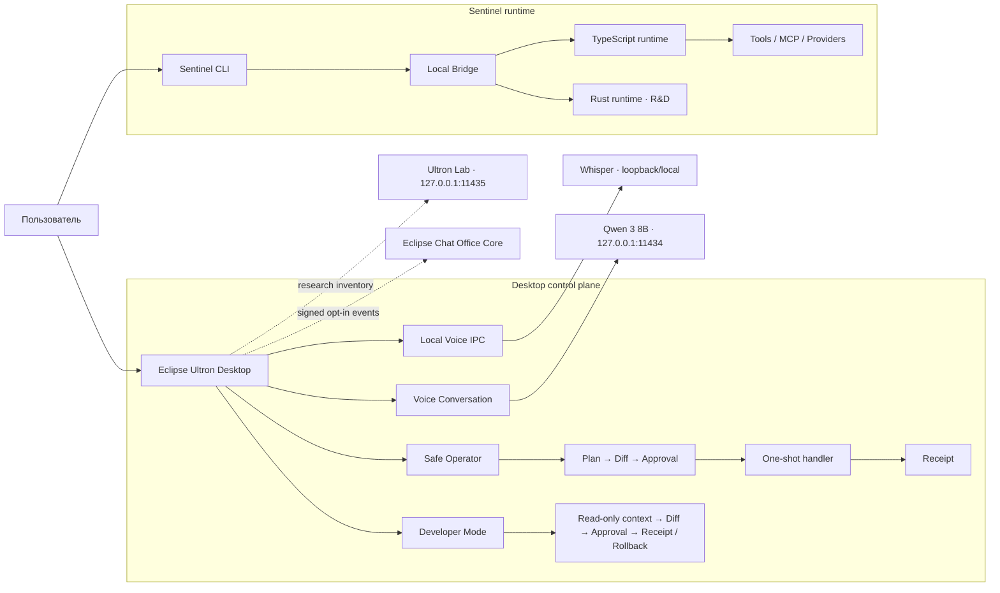

<div align="center">


# Eclipse Ultron

<!-- project-links:start -->
[Документация](docs/repository-guide.md) · [Код](https://github.com/PavelHopson/eclipse-hopson-sentinel/tree/main) · [История изменений](https://github.com/PavelHopson/eclipse-hopson-sentinel/commits/main/)
<!-- project-links:end -->

### Локальный AI command center: голос → план → approval → действие → receipt

[](https://github.com/PavelHopson/eclipse-hopson-sentinel/actions/workflows/ci.yml)


**Eclipse Ultron** — пользовательское desktop-приложение Eclipse Forge.<br/>
**Sentinel** — его совместимый runtime, CLI, IPC и набор инженерных контрактов.

[Возможности](#что-уже-работает) · [Архитектура](#архитектура) · [Быстрый старт](#быстрый-старт) · [Голос](#голосовая-связь) · [Безопасность](#модель-безопасности) · [Документация](#документация)

[Локальный пилот «Цифровой след»](experiments/footprint-pilot/README.md) — отдельный процесс: источники, ручной граф доказательств и одноразовое согласие перед запросом. По умолчанию без внешней сети; не входит в установленный Electron-пакет.

</div>

---

<!-- eclipse-forge-projects:start -->
## Проекты Eclipse Forge

[Главная Eclipse Forge](https://eclipse-forge.ru/) · [Eclipse Library](https://library.eclipse-forge.ru/) · [Eclipse DnD Forge](https://dnd.eclipse-forge.ru/)

Исходный код: [Eclipse Forge Landing](https://github.com/PavelHopson/Eclipse-forge-website) · [Eclipse Chat](https://github.com/PavelHopson/eclipse-chat) · [Eclipse Connect](https://github.com/PavelHopson/eclipse-connect) · [Eclipse Library](https://github.com/PavelHopson/eclipse-library) · [Eclipse AI Hub](https://github.com/PavelHopson/eclipse-ai-hub) · [Eclipse Ultron / Sentinel](https://github.com/PavelHopson/eclipse-hopson-sentinel) · [Eclipse Webclaw](https://github.com/PavelHopson/Eclipse-webclaw) · [Eclipse DnD Forge](https://github.com/PavelHopson/eclipse-dnd-forge) · [Finflow](https://github.com/PavelHopson/finflow) · [Eclipse Media](https://github.com/PavelHopson/eclipse-media) · [Shotforge](https://github.com/PavelHopson/shotforge) · [Text2Image](https://github.com/PavelHopson/Text2Image) · [Educator AI](https://github.com/PavelHopson/Educator-AI) · [@pavelhopson/retry-http](https://github.com/PavelHopson/retry-http)
<!-- eclipse-forge-projects:end -->

<!-- repository-guide:start -->
[Интерфейс](#readme-interface) · [Первый запуск](#readme-start) · [Что внутри](#readme-map) · [Путеводитель](docs/repository-guide.md#start) · [Карта кода](docs/repository-guide.md#map) · [Проверки](docs/repository-guide.md#checks) · [Границы и права](docs/repository-guide.md#boundaries)

<a id="readme-interface"></a>

## Интерфейс


**Голосовой экран Альтрона в ожидании команды. Микрофон и локальные модели не запускались.**

Локальный снимок от 8 сентября 2026: отдельный профиль браузера, без внешних API и пользовательских секретов. Это вид интерфейса, не подтверждение production-функций.

<details>
<summary><strong>Мобильный экран · 390 px</strong></summary>


</details>

[Открыть в полном размере](docs/assets/ui/overview.png) · [Данные снимка](docs/assets/ui/capture.json)

<a id="readme-map"></a>

## Проект за минуту

- **[Интерфейс Альтрона](<dashboard/src>)** — Голосовое рабочее пространство и настройки помощника.
- **[Desktop runtime](<dashboard/electron>)** — Связь интерфейса с локальными возможностями Windows.
- **[Голосовой конвейер](<scripts/voice-runtime>)** — Управление локальными компонентами голосовой сессии.

<a id="readme-start"></a>

## Начать локально

**Среда:** Node.js и npm. **Источник:** [dashboard/package.json](<dashboard/package.json>).

Из корня клонированного репозитория:

```bash
cd dashboard
npm ci
npm run dev
```

Запускается веб-интерфейс dashboard. Electron, голосовые модели и Sentinel Core на Bun настраиваются отдельно; эта команда не запускает всю голосовую систему.

<details>
<summary><strong>Перед первым запуском и изменением кода</strong></summary>

- Команды сверены с исходниками 8 сентября 2026. Это инструкция, а не отметка об успешном запуске или текущем production.
- Установка зависимостей может обращаться в registry и выполнять lifecycle scripts. Используйте отдельную рабочую среду и демонстрационные данные.
- Микрофон, управление компьютером и системные действия включаются только по явному разрешению; новые права не выводятся из голосового запроса.
- [SECURITY.md](<SECURITY.md>)

</details>
<!-- repository-guide:end -->

## Зачем существует Ultron

Большинство AI-интерфейсов скрывает слишком много: где обрабатываются данные, что именно
собирается выполнить агент и как проверить результат. Eclipse Ultron строится вокруг другой
модели взаимодействия:

1. пользователь явно формулирует или произносит команду;
2. Ultron показывает план и ожидаемый diff;
3. человек подтверждает ограниченное действие;
4. runtime выполняет один разрешённый handler;
5. интерфейс возвращает проверяемый receipt.

Это не обещание автономного «управления всем компьютером». Текущий desktop-контур ограничен
read-only диагностикой и отдельными least-privilege workflows с diff, ручным approval, receipt
и проверяемым откатом.

## Что уже работает

| Поверхность | Что даёт | Текущая граница |
| --- | --- | --- |
| **Альтрон** | центральный voice-first диалог: явный live STT, потоковый локальный ответ и быстрый neural TTS | без text composer, wake word и автозапуска микрофона |
| **Voice Actions** | «Открой YouTube» через deterministic intent, preview и one-shot receipt | только fixed `https://www.youtube.com/`; произвольные URL запрещены |
| **Operator** | command room с plan, diff, approval и receipt | execute требует отдельного approval и снятия STOP |
| **Developer Mode** | read-only контекст Git → локальный 27B proposal → diff → approval → receipt/rollback | только существующие allowlisted text-файлы; без shell, сети, секретов и фоновой записи |
| **Ultron Lab** | изолированный инвентарь 27B research-моделей | не участвует в живом голосе; без tools, shell, filesystem, network и execute |
| **Sentinel CLI** | coding-agent, provider routing, bridge и MCP contracts | расширенные права зависят от явной конфигурации |
| **Office bridge** | подписанные локальные события для Eclipse Chat | opt-in, bounded payloads, replay protection |
| **Windows Doctor** | read-only security posture audit | диагностика без автоматического remediation |
| **Диагностика** | один экран состояния E-storage, Whisper, Piper, Qwen 8B/27B и media guard | read-only; не включает микрофон и не загружает модели |

<p align="center">
  
</p>

## Голосовая связь

Текущая локально установленная версия: **1.2.22**; файлы и версия проверены по хешам.
После обновления и перезапуска пользователь подтвердил озвучку ответа в **1.2.22**.
Ранее скриншот подтвердил распознавание «два плюс два» и текст «4.». Длительный живой разговор,
повторное прослушивание и Stop пока требуют отдельной проверки. Ошибки Piper, DSP и загрузки
runtime теперь имеют отдельные безопасные коды `TTS_…`; точная причина прежнего сбоя не установлена.
Whisper запускается напрямую в native VAD-режиме
(`--step 0`), принимает завершённые блоки и сообщает готовность только после native marker.
GUI-лаунчер Ollama изолирует консольное наследование; короткая голосовая реплика ранее была
подтверждена на **1.2.19**, но это не подтверждение работоспособности текущего сценария.
[Протокол установленной версии](docs/ultron-1.2.19-console-and-voice-recovery.md).

В изолированном голосовом hotfix **1.2.21** подготовка модели отделена от ответа,
Stop ждёт реального завершения Whisper, ранний resume не изображает готовый микрофон,
а защита от шума допускает девять обычных коротких реплик подряд. Основной checkout остаётся
**1.2.20** с отдельной, ещё не выпускаемой здесь работой над журналом AI Hub.
[Точный статус, измерения, установка и ограничения](docs/ultron-voice-readiness-2026-09-08.md).

Голос: закреплённый **Piper Denis + Ultron DSP**. Диалог: **Qwen 3 8B**, не тяжёлая 27B-модель.
Распознавание: локальный Whisper и DirectSound device `0`; после смены устройства порядок
микрофонов может измениться. Открытие диагностики не включает микрофон и не загружает модели.

<table>
  <tr>
    <td width="170" align="center">
      
    </td>
    <td>
      <strong>Альтрон — основной экран, а не дополнение к текстовому чату.</strong><br/><br/>
      «Включить живой разговор» запускает один persistent Whisper process. После этого
      можно говорить без повторного клика: Альтрон приглушает transcript delivery во время
      ответа и сам возвращается к прослушиванию. Микрофон не запускается автоматически,
      активное состояние видно на экране и в tray.
    </td>
  </tr>
</table>

Локальный voice pipeline:

```text
explicit live start
    └─> trusted Electron IPC (fixed executable/model)
          └─> whisper.cpp + large-v3-turbo-q5_0
                └─> transcript in memory
                      └─> cancellable Qwen 3 8B preparation → bounded streaming answer
                            └─> first complete sentence → pinned Piper Denis
                                  └─> bounded raw PCM → Ultron DSP sandbox → memory MP3 playback

Voice Action: deterministic intent → fixed target preview → manual approval → browser → receipt
Operator: explicit dictation → editable command → plan → diff → approval → receipt
```

- один persistent STT process только после явного включения; stop доступен в UI и tray;
- USB-микрофоны открываются через локальный SDL DirectSound backend с согласованием `16 kHz / mono`;
- фиксированный timeout и rate limit;
- bounded JSON output;
- microphone audio и транскрипт не сохраняются; TTS принимает только закреплённые executable,
  модель и config, ограничивает raw PCM и возвращает обработанный MP3 только в память;
- визуальные состояния `listening / thinking / speaking / success / error` синхронизированы с turn;
- production TTS ограничен 240 символами на chunk, 1.2 MiB PCM и 20 секундами; голос можно остановить вручную;
- основной voice — CC0 Piper `ru_RU-denis-medium` с фиксированным Ultron DSP; браузерный/SAPI fallback намеренно запрещён;
- post-install smoke текущего production TTS подготовил MP3 за 0.795 сек; CPU Qwen3-TTS превысил пять минут и оставлен только как Studio/Lab evidence, а не живой голос;
- Qwen 8B показал 175.803 сек при холодном чтении после unload и 5.511 сек при повторной загрузке в GPU; warm-цифра не выдаётся за cold latency;
- модель запускается только после явного голосового действия, остаётся тёплой не более пяти минут,
  получает восемь последних сообщений, отвечает до 120 токенов и начинает говорить по первой законченной фразе;
- wake word, startup capture и standing microphone authorization отсутствуют.

Подробности: [Eclipse Ultron Local AI Runtime](docs/ultron-local-ai-runtime.md).

## Архитектура



### Принцип разделения

- **Ultron** отвечает за понятный desktop UX и видимые состояния.
- **Sentinel** сохраняет стабильные CLI, storage и IPC-контракты.
- **Policy Gate** определяет полномочия; модель не может расширить их текстовым ответом.
- **Local AI Runtime** хранится отдельно от Git и installer: бинарники и веса не попадают в репозиторий.

## Модель безопасности

| Контроль | Реализация |
| --- | --- |
| Human approval | execute недоступен до preview плана и явного подтверждения |
| One-shot permission | approval сгорает после одного результата |
| Kill switch | STOP включён по умолчанию и блокирует execute |
| Voice privacy | явный live start, видимый active state, one-click/tray stop, без audio persistence |
| Renderer boundary | fixed IPC channel, zero user-controlled process arguments |
| Process safety | `spawn`, `shell: false`, timeout, output limit, one in-flight process |
| Local endpoints | Ollama profiles слушают только loopback |
| Lab isolation | 27B-модель получает только bounded text context; CPU-only inference выгружается после proposal |
| Developer write gate | только существующие text-файлы из read-only context; hash precondition, expiring exact approval, atomic replace и rollback |
| Resource governor | нет автозапуска Lab/прогрева на старте; voice и Developer Mode взаимно блокируют тяжёлые операции |
| Office transport | bounded signed events, nonce/replay protection, explicit opt-in |
| Browser action | fixed YouTube target, expiring preview, exact one-shot approval и receipt; model/user URL не принимается |
| Browser worker | произвольный read-only browsing требует отдельной изоляции и allowlist |

> Ответ любой модели считается недоверенным текстом. Наличие локальной модели не превращает
> её в policy engine и не даёт прав на shell, secrets, install, deploy или изменение файлов.

## Локальные модели: честный профиль

| Профиль | Endpoint | Назначение | Default |
| --- | --- | --- | --- |
| `qwen3:8b` | `127.0.0.1:11434` | живой голосовой диалог | да, закреплён |
| `huihui_ai/qwen3.8-abliterated:27b` | `127.0.0.1:11435` | исследовательский кандидат; manifest сейчас не подтверждён | нет |
| OrcaRouter Qwen3.8 27B Q4 | `127.0.0.1:11435` | установленный Lab-кандидат; сравнительный benchmark ожидается | нет |
| `qwen3.8-cyber-iq4xs:27b` | `127.0.0.1:11435` | cyjin-yl IQ4_XS GGUF, только после ручного импорта и проверки SHA-256 | нет |

Измерение 27B Q4_K_M на RTX 4060 Ti 16 GiB / 64 GiB RAM, `num_ctx=8192`, `think=false`:

| Режим | Load | Generation | Total |
| --- | ---: | ---: | ---: |
| cold start | 233.3 s | 8.2 tok/s | 254.56 s |
| warm request | 0 s | 6.98 tok/s | 5.07 s |

Практический вывод: 27B работает, но почти четырёхминутный cold start исключает её из
default-профиля. Она остаётся opt-in Lab-моделью без инструментов; для повседневного диалога
разумнее `qwen3:8b`.

Для подключения именно Qwen3.8 Cyber используйте [явный установщик Lab](scripts/install-qwen38-cyber.ps1).
Он скачивает только non-MTP GGUF, проверяет SHA-256 и создаёт локальный Ollama alias
`qwen3.8-cyber-iq4xs:27b` на `127.0.0.1:11435`. Установщик не запускается при старте приложения,
не кладёт веса в Git и задаёт начальный контекст 8K. Модель остаётся текстовым Lab-профилем без
tools, shell, filesystem, network, secrets, install, deploy и Operator execute.
Developer Mode использует только фактически найденный 27B Qwen3.8-tag и показывает его в UI.
Название HuiHui не подставляется автоматически: отсутствие manifest считается фактом, а не
поводом скрытно скачивать или переименовывать модель. Подробный контракт:
[Developer Mode и E:-first storage](docs/ultron-developer-mode-storage.md).

## Быстрый старт

### Desktop development

Требования: Windows 10/11, Node.js 20+, npm. Для локального голоса нужен отдельно
подготовленный [Eclipse AI Runtime](docs/ultron-local-ai-runtime.md).

```powershell
cd dashboard
npm ci
npm run dev
```

Electron development:

```powershell
cd dashboard
npm run electron:dev
```

Production build и локальный NSIS installer:

```powershell
cd dashboard
npm run electron:build
```

Готовый файл появляется в `dashboard/release/`. Текущий installer предназначен для
внутреннего тестирования: публичное распространение заблокировано до code signing и
provenance review.

### Sentinel Core

Требования: Bun 1.3.12+, Node.js 20+.

```powershell
bun install --frozen-lockfile
bun run build
node .\bin\sentinel --version
```

Диагностика среды:

```powershell
bun run doctor:runtime
bun run doctor:windows
```

## Проверки качества

Русская диктовка (без микрофона, сети и модельных вызовов):

```powershell
npm run test:voice
npm run eval:voice
```

Первый вызов проверяет обработку частичных фраз и отмену. Второй без входного файла
показывает «не измерено», а не выдуманную точность модели. Корпус из 30 фраз, локальный
JSON и границы измерений: [тест русской диктовки](docs/ru-dictation-evaluation.md).

Для отдельного выбранного WAV есть `npm run eval:voice:recording`: без аргументов он
только показывает три стартовые фразы. `--check` проверяет файл без модели; `--run`
с отдельным флагом согласия запускает установленный локальный Whisper. Микрофон и облако
не включаются, оригинал не меняется, текст не записывается в отчёт. Команды и ограничения
формата — в документе выше. Человеческая диктовка пока не измерена.

Desktop:

```powershell
cd dashboard
npm run lint
npm run build
npm audit
```

Focused security/UX contracts:

```powershell
node --test scripts/dashboard-security.test.mjs
node --test scripts/dashboard-operator-security.test.mjs
node --test scripts/dashboard-ultron-security.contract.mjs
node --test scripts/dashboard-branding.contract.mjs
node --test scripts/dashboard-usage-guide.contract.mjs
```

Runtime:

```powershell
bun test
bun run typecheck:supported
bun run typecheck:debt
bun run smoke
```

CI выполняет Bun build/tests, supported-contract typecheck, inherited-debt guard, Python
provider tests и Windows Doctor self-test.

## Структура репозитория

```text
eclipse-hopson-sentinel/
├── dashboard/              # Eclipse Ultron · React + Electron + NSIS
│   ├── electron/           # trusted main/preload и Safe Operator IPC
│   ├── src/                # Voice Conversation, Operator, Settings
│   └── public/brand/       # first-party Ultron visual assets
├── src/                    # Sentinel TypeScript runtime
├── rust/                   # next-generation runtime track
├── bin/                    # sentinel / voice / operator entrypoints
├── office/                 # Eclipse Chat Office event bridge
├── scripts/                # doctors, security gates, build and voice adapters
└── docs/                   # contracts, ADR, setup, roadmap and engineering log
```

## Документация

| Раздел | Документ |
| --- | --- |
| Первый запуск | [Windows quick start](docs/quick-start-windows.md) |
| Установщик | [Windows installer](docs/windows-installer.md) |
| Локальный голос и модели | [Ultron Local AI Runtime](docs/ultron-local-ai-runtime.md) |
| Реестр и evidence моделей | [Ultron model registry](docs/ultron-model-registry.md) |
| Safe Operator | [Operator contract](docs/sentinel-safe-operator.md) |
| Voice architecture | [Voice plan](docs/sentinel-voice-plan.md) |
| Bridge API | [Sentinel Bridge](docs/sentinel-bridge.md) |
| Office Core | [Office bridge](docs/sentinel-office-bridge.md) |
| Конфигурация | [Config Health](docs/sentinel-config-health.md) |
| Диагностика Windows | [Windows Doctor](docs/sentinel-windows-doctor.md) |
| Архитектурные решения | [Hybrid architecture](docs/hybrid-architecture.md) |
| План развития | [Sentinel roadmap](docs/sentinel-roadmap.md) |
| Изменения | [Engineering log](docs/sentinel-engineering-log.md) |

## Ближайший roadmap

- signed Windows releases и проверяемые update artifacts;
- cancellable voice session и явный retry без фонового listening;
- компактный always-on-top contact mode;
- локальная инвентаризация моделей с безопасным выбором default;
- новые capabilities только как отдельные least-privilege contracts с preview и rollback;
- production credential lifecycle для opt-in Eclipse Chat Office bridge.

Актуальный источник истины: [docs/sentinel-roadmap.md](docs/sentinel-roadmap.md).

## Статус и происхождение

Проект находится в активной разработке и пока не является публичным массовым дистрибутивом.
Desktop-приложение и Eclipse-контракты развиваются как first-party слой, но исходный CLI-код
имеет смешанное происхождение. До фиксации точных upstream SHA и юридической проверки:

- npm package остаётся `private`;
- публичная публикация и продажа дистрибутива запрещены;
- unsigned installer используется только локально;
- условия определяются [LICENSE](LICENSE) и [THIRD_PARTY_NOTICES.md](THIRD_PARTY_NOTICES.md).

Security issues следует сообщать по процедуре из [SECURITY.md](SECURITY.md), не через
публичный issue с чувствительными деталями.

---

<div align="center">

**Eclipse Forge · инженерные системы, в которых действие видно до выполнения**

</div>
